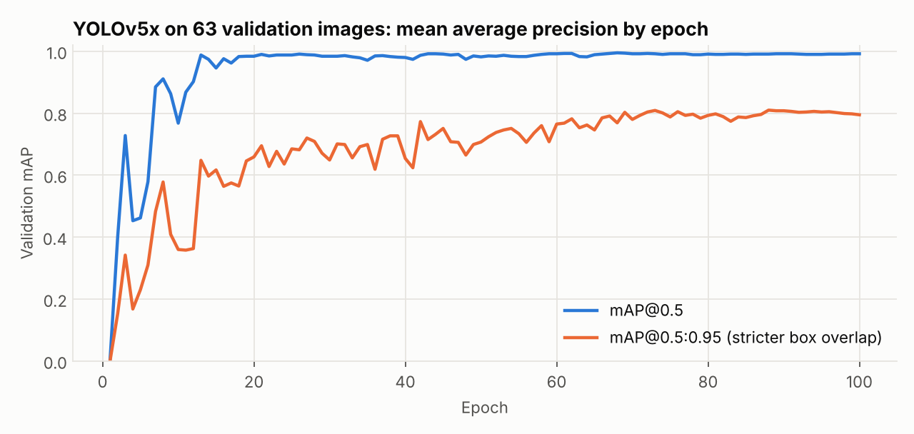
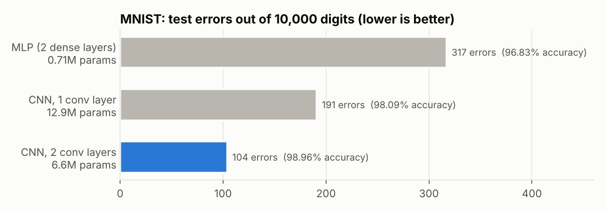
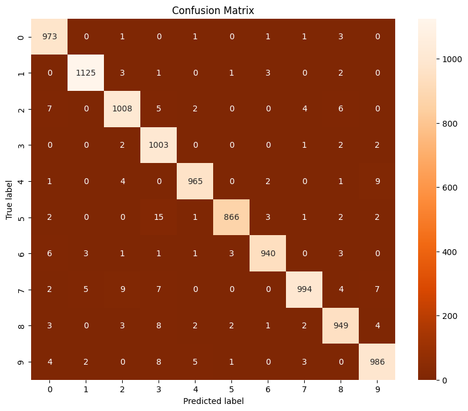
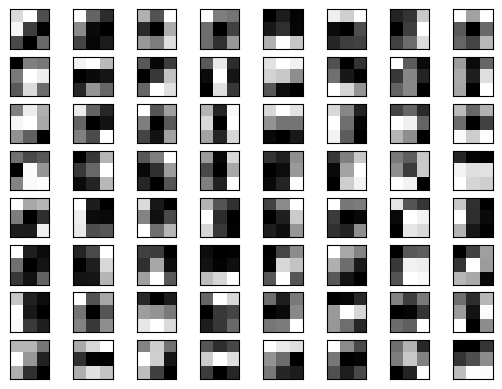
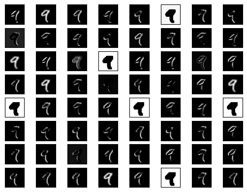

# Deep Learning with Computer Vision

MSc coursework (2024) in three parts, each going a step further:

1. **Image classification:** a dense network vs convolutional networks on MNIST handwritten digits.
2. **Inside a pretrained CNN:** visualising what VGG16's filters and feature maps respond to.
3. **Object detection:** fine-tuning **YOLOv5x** and **DETR** (a transformer detector) to find drones in photos.

Python · TensorFlow/Keras · PyTorch · YOLOv5 (Ultralytics) · DETR (Hugging Face Transformers) · PyTorch Lightning · Roboflow

## Results at a glance

| Task | Model | Result |
|---|---|---|
| Drone detection | YOLOv5x (86M params) | **mAP@0.5 0.991**, mAP@0.5:0.95 0.810, precision 1.00, recall 0.984 *(validation set, 63 images)* |
| Drone detection | DETR, ResNet-50 (41.5M params) | **AP@0.5 0.972**, AP@0.5:0.95 0.716, AR 0.785 *(held-out test set, 63 images)* |
| Digit classification | CNN with 2 conv layers | **98.96%** test accuracy (104 errors in 10,000) |
| Digit classification | Dense network (MLP) | 96.83% test accuracy (317 errors) |

---

## 1. Drone detection with YOLOv5 and DETR

Detecting small drones in everyday scenes is a real security problem, and it complements my [MSc thesis](https://github.com/Rovell2002/Drone-WiFi-Signal-Classification), which detects drones from their radio signals instead of images.

**Data:** 314 photos of drones, labelled with bounding boxes in one class (*Drone*), resized to 640×640 and split 188 / 63 / 63 (train / validation / test) in Roboflow. The images are stock photos, so the dataset is not included in this repository.

### YOLOv5x (`drone_detection_yolov5.ipynb`)

- Fine-tuned from COCO-pretrained `yolov5x.pt` for 100 epochs: image size 640, batch 12, about 45 minutes on a Colab GPU.
- **Best checkpoint on the validation set:** precision 1.000, recall 0.984 (62 of 63 drones found), mAP@0.5 0.991, mAP@0.5:0.95 0.810.

mAP@0.5 (a box counts if it overlaps the true box by at least 50%) passes 0.98 within about 20 epochs. The stricter mAP@0.5:0.95, which also rewards tight boxes, keeps improving until about epoch 90. So most of the extra training went into **localising** drones more precisely, not into finding them.

### DETR (`drone_detection_detr.ipynb`)

DETR (DEtection TRansformer) treats detection as a set-prediction problem: a transformer outputs a fixed set of 100 box predictions that are matched to the ground truth. This avoids hand-designed anchors and non-maximum suppression.

- Fine-tuned `facebook/detr-resnet-50` for 50 epochs with PyTorch Lightning on a Tesla T4. Settings: AdamW (learning rate 1e-4, and 1e-5 for the ResNet backbone), weight decay 1e-4, batch 4 with 8-step gradient accumulation, gradient clipping 0.1.
- **Held-out test set (COCO evaluation):** AP@0.5 0.972, AP@0.75 0.791, AP@0.5:0.95 0.716, AR 0.785.

### Comparing the two

YOLOv5x scores higher, especially on box precision (0.81 vs 0.72 mAP@0.5:0.95). The comparison is **not like-for-like**, though:
- YOLO's numbers come from the validation set, which was also used to pick its best checkpoint.
- DETR's numbers come from the separate test set.
- YOLOv5x has twice as many parameters and trained for twice as many epochs.
- 63 images is a small evaluation set.

A fair comparison would evaluate both on the same test set.

## 2. MNIST: dense network vs CNNs

All three models were trained for 10 epochs with plain SGD on the 60,000 training digits and evaluated on the 10,000 test digits.

| Notebook | Architecture | Params | Test accuracy |
|---|---|---|---|
| `mnist_mlp.ipynb` | Dense 532 → Dense 532 → 10 | 0.71M | 96.83% |
| `mnist_cnn_1conv.ipynb` | Conv 64 (4×4) → MaxPool → Dense 1024 → 10 | 12.9M | 98.09% |
| `mnist_cnn_2conv.ipynb` | Conv 64 → MaxPool → Conv 128 → MaxPool → Dense 1024 → 10 | 6.6M | **98.96%** |

- **Convolutions cut the errors by two thirds** (317 → 104). They see local stroke patterns, while the dense network sees 784 unrelated pixels.
- **The deeper CNN is also half the size.** The second pooling layer shrinks the feature maps from 14×14 to 7×7, so even with twice the channels, the large dense layer after it needs half the weights. Most of a small CNN's parameters sit in that dense layer, not in the convolutions.
- **The commonest mistake** (1-conv CNN) is a 5 read as a 3 (15 times), followed by 4 → 9 and 7 → 2.

## 3. Inside VGG16 (`vgg16_filters_and_feature_maps.ipynb`)

VGG16 with ImageNet weights is loaded without its classifier. MNIST digits are padded and resized to 48×48 and copied into 3 channels, because VGG16 expects colour images.

| Learned 3×3 filters (`block1_conv2`, first input channel) | Feature maps of a "9" after `block1_conv1` |
|---|---|
|  |  |

The first-layer filters are simple edge and contrast detectors. Applied to a digit, each one highlights different strokes or edges, and a few invert the image. Deeper layers combine these into more abstract shapes.

## Limitations

- **Single runs.** Each model was trained once, so small differences, such as 98.09% vs 98.96%, are not tested across seeds.
- **Test data was also used for monitoring.** The MNIST notebooks pass the test set as `validation_data` to watch training. Epochs were fixed at 10, so no model was tuned on it, but a separate validation split is better practice.
- **Small detection dataset.** 314 stock photos, mostly with one large, centred drone, are much easier than real surveillance footage of small, distant drones.
- **The VGG16 classifier head is built but not trained.** That notebook is for visualisation only. ImageNet preprocessing (`preprocess_input`) was also not applied.

## How to run

The notebooks were written for **Google Colab with a GPU runtime**, and each one installs its own dependencies.

- **MNIST and VGG16 notebooks:** run as they are; MNIST downloads automatically through Keras.
- **YOLOv5:** clone [ultralytics/yolov5](https://github.com/ultralytics/yolov5) and point `data.yaml` at your own YOLO-format dataset.
- **DETR:** downloads a COCO-format dataset from Roboflow. Enter your own Roboflow API key when prompted; it is never stored in the notebook.

## Credits

- The DETR notebook follows Roboflow's [DETR fine-tuning tutorial](https://github.com/roboflow/notebooks), which builds on Niels Rogge's Hugging Face DETR examples.
- YOLOv5 by [Ultralytics](https://github.com/ultralytics/yolov5).
- VGG16: Simonyan & Zisserman, *Very Deep Convolutional Networks for Large-Scale Image Recognition*, 2015.
- DETR: Carion et al., *End-to-End Object Detection with Transformers*, ECCV 2020.
